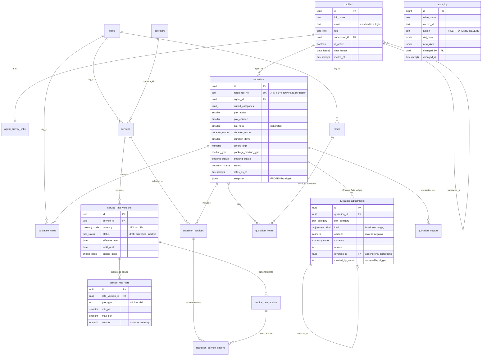
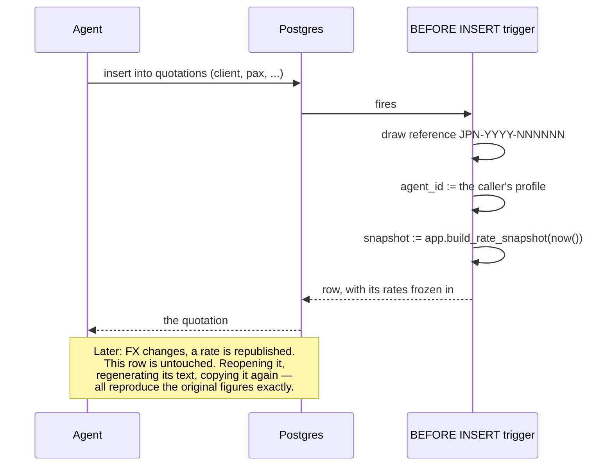
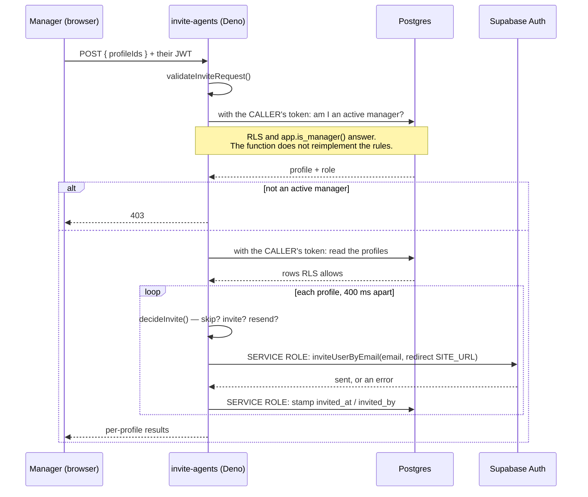

# EZQUOTE Japan — architecture

A React single-page app on top of Supabase (Postgres). The deliberate choice
running through all of it: **the database owns pricing integrity, not the
browser.** Anything a client could lie about is decided in SQL.

- **Front end:** React 19, Vite 8, TypeScript 6 strict, Tailwind CSS 4,
  react-router 8, @tanstack/react-query 5, Radix primitives
- **Back end:** Supabase — Postgres with Row Level Security, Auth, one Edge
  Function (Deno)
- **No server of our own.** Static files on Cloudflare Pages; the browser talks
  to Supabase directly, and RLS is the authorisation layer.

---

## Contents

1. [How the pieces fit](#1-how-the-pieces-fit)
2. [Entity relationships](#2-entity-relationships)
3. [The snapshot design](#3-the-snapshot-design)
4. [The rate engine](#4-the-rate-engine)
5. [The RLS role matrix](#5-the-rls-role-matrix)
6. [The audit design](#6-the-audit-design)
7. [The Edge Function flow](#7-the-edge-function-flow)
8. [Layering rules](#8-layering-rules)
9. [Extension points](#9-extension-points)

---

## 1. How the pieces fit

```mermaid
flowchart TB
    subgraph browser["Browser"]
        ui["features/ · React screens"]
        domain["domain/ · pure TypeScript<br/>rate engine, rounding, tiers,<br/>itinerary, output, filters"]
        data["data/repositories · Supabase calls"]
        ui --> domain
        ui --> data
        data --> domain
    end

    subgraph cf["Cloudflare Pages"]
        static["dist/ · static files<br/>_headers (CSP) · _redirects (SPA)"]
    end

    subgraph sb["Supabase project"]
        auth["Auth · email + password"]
        pg[("Postgres<br/>24 tables · RLS on every one")]
        fn["Edge Function<br/>invite-agents (Deno)"]
        trig["Triggers<br/>snapshot builder · guards · audit"]
        pg --- trig
    end

    browser -->|"loads from"| static
    data -->|"PostgREST, publishable key + user JWT"| pg
    ui -->|"sign in / set password"| auth
    ui -->|"invoke"| fn
    fn -->|"caller's JWT: is this an active manager?"| pg
    fn -->|"service-role key: auth.admin.inviteUserByEmail"| auth

    style domain fill:#eef5ff
    style pg fill:#eef5ff
```



Two things to notice.

**`domain/` has no dependencies.** No React, no Supabase, no DOM — ESLint
enforces it. That is what lets the same pricing rules run in the browser, in the
seed script and in the UAT suite, with no chance of three slightly different
answers.

**The Edge Function uses two different clients on purpose.** The caller's token
to ask Postgres "is this an active manager?", so the permission rules live in one
place; and only then the service-role key to reach `auth.admin`. That key never
leaves the Edge runtime.

---

## 2. Entity relationships

24 tables. Reference data, then rates, then quotations, then the log.



Not shown, because nothing references them: `fx_rates`, `category_markups`,
`service_markups` (all append-only), `pax_categories` (the divisor and multiplier
rules), `content_items` (inclusions, exclusions, notes, remarks), `booking_sites`
and `app_settings`.

### Why `profiles` is separate from `auth.users`

158 agents existed in a spreadsheet before any of them had a login. So a profile
is a record of a person; a login is how they get in; the two are **matched by
email on first sign-in**. An unrecognised email gets an inactive profile for a
manager to approve, rather than silent access.

The consequence to remember: **email is the join key.** A typo creates a second
profile instead of linking to the intended one.

---

## 3. The snapshot design

### The problem

An agent quotes a client PHP 19,099. Three days later Product Development moves
the yen rate from 0.50 to 0.42. The client calls back to book. What is the price?

If the app recalculates, the number changed under both of them — and the agent
has no way to show what they originally sent.

### The answer

**Every quotation carries its own copy of every rate it needs, frozen when it was
created.**

`quotations.snapshot` is a `jsonb` column holding the FX table, the category and
service markups, the pax-category rules, and every published, unexpired rate
version with its tiers and add-ons — as it stood at that moment.



Four properties follow, and all four are tested:

1. **The browser cannot influence pricing.** It does not send rates; it sends a
   selection. `app.build_rate_snapshot()` runs in a `BEFORE INSERT` trigger as
   `SECURITY DEFINER`, and the API roles cannot execute it directly.
2. **Rate changes only reach new quotations.** Nothing rewrites history.
3. **A quotation may only use services in its own snapshot.** Enforced in
   `set_quotation_services`, so a service added today cannot be smuggled into a
   quote made last week.
4. **Replaying a quotation is deterministic.** `calculateQuotation()` is pure, and
   the snapshot is one of its inputs.

### What is _not_ frozen

Content text — inclusions, exclusions, notes, remarks, itinerary wording — is read
live. A typo fix should reach every quotation, including ones already created.
**Rates are frozen; words are not.** That is the line, and it is the one thing to
remember when deciding where something new belongs.

### Requoting

An agent who wants today's rates uses **Requote with current rates**:
`duplicate_quotation()` copies the quotation, and because the copy is a fresh
insert it gets a fresh snapshot. The original is untouched. Anything no longer on
sale cannot be copied, so the function returns what it skipped and the UI says so
— a silently thinner quote would be worse than a warning.

`preview_current_snapshot()` builds a snapshot without saving anything, which is
what the "compare with current rates" panel diffs against
(`domain/quotation/snapshotDiff.ts`).

---

## 4. The rate engine

`src/domain/rateEngine.ts`. Pure, deterministic, and the single source of every
figure the app shows. Money is **integer centavos** throughout; FX is scaled by
1e6 to match `numeric(12,6)`. No floats in money arithmetic.

### The formula

Per person, per occupancy category:

```
hotel per person   = room cost / divisor x multiplier
services           = Σ (tier amount + selected add-ons) converted to PHP
service markups    = Σ markup per service type  (tour +1,000, transfer +2,000)
category markup    = fixed PHP, or percent of the base
package markup     = fixed PHP, or percent of the base
airfare            = entered manually
change rate        = Σ non-hotel ledger entries, converted

subtotal = hotel + services + service markups + category markup
         + package markup + airfare + change rate

final    = roundUpTo99(subtotal)
```

**The group-size tier is chosen by the TOTAL number of travellers in the
quotation, children included** — not by how many people are in the category being
priced. A quad rate for a party of seven uses the 7–9 band.

### The percent markup base

A percentage needs something to be a percentage _of_, and the choice is a business
rule, not an implementation detail:

```
base = hotel per person
     + converted tour and transfer rates (tiers + add-ons)

excludes: the tour/transfer markups, airfare,
          and non-hotel Change Rate entries
```

So a 10% category markup on a 13,550 base is 1,355 — it does not compound on the
fixed service markups, and adding a 25,000 airfare does not multiply the markup.

### Hotel divisors

The entered figure is a **room** cost, except for Solo.

| Category | Divisor | Multiplier | A 20,000 room becomes   | Why                                                                                             |
| -------- | ------- | ---------- | ----------------------- | ----------------------------------------------------------------------------------------------- |
| quad     | 4       | 1          | 5,000                   | four sharing                                                                                    |
| triple   | 3       | 1          | 6,666.67                | three sharing                                                                                   |
| twin     | 2       | 1          | 10,000                  | two sharing                                                                                     |
| solo     | 1       | 2          | **×2 of what you type** | the entered value is the **per-person twin rate**, and a solo traveller pays for the whole room |
| child    | 1       | 1          | as entered              | entered per child                                                                               |
| sneak_in | 1       | 1          | as entered              | no bed of their own                                                                             |

Solo is the one that surprises people: type 6,000 (the per-person twin rate) and
the hotel line reads 12,000. The rules live in the `pax_categories` table, not in
code, so they are visible and changeable.

### Rounding

**Round UP to the next number ending in 99.** Always up, never to nearest:
rounding down would sell below cost.

| Subtotal | Final                                   |
| -------- | --------------------------------------- |
| 13,957   | 13,999                                  |
| 13,050   | 13,099                                  |
| 13,099   | 13,099 (already ends in 99 — unchanged) |
| 13,100   | 13,199                                  |
| 1        | 99                                      |

The difference appears as its own `rounding` line in the breakdown, so the lines
always sum exactly to the final rate. A test asserts that reconciliation across a
wide sweep of inputs, and the UI logs an error if it ever fails.

### Issues, not exceptions

The engine never throws for a business problem. It returns `issues` with a
severity, so the UI can show a warning and still price (`MISSING_HOTEL_COST`) or
block generation (`NO_TIER_FOR_PAX`, `SERVICE_NOT_IN_SNAPSHOT`,
`PRIVATE_TOTAL_NOT_SUPPORTED`). An agent mid-quote needs to be told what is
missing, not handed a blank screen.

---

## 5. The RLS role matrix

Row Level Security is on **every** table. The front end hides buttons for
convenience; the database is what actually says no.

Five roles. `super_admin`, `product_development` and `admin` are collectively
**managers** (`app.is_manager()`).

### Reference and rate data

| Table                                                                | Agent                   | Supervisor          | Managers                         |
| -------------------------------------------------------------------- | ----------------------- | ------------------- | -------------------------------- |
| `cities`, `operators`, `hotels`, `booking_sites`, `services`         | read                    | read                | **write**                        |
| `content_items`, `app_settings`                                      | read                    | read                | **write**                        |
| `pax_categories`                                                     | read                    | read                | read (structural; nobody writes) |
| `service_rate_versions`, `service_rate_tiers`, `service_rate_addons` | read **published only** | read published only | **write**                        |
| `fx_rates`, `category_markups`, `service_markups`                    | read                    | read                | **insert only** (append-only)    |

Drafts are invisible to agents, so a half-finished price can never be quoted.
FX and markups have `UPDATE` and `DELETE` **revoked at the privilege level**, not
merely policy-denied — a change is a new row.

### Quotations

| Table                                                                                    | Agent                | Supervisor           | Managers        |
| ---------------------------------------------------------------------------------------- | -------------------- | -------------------- | --------------- |
| `quotations`                                                                             | own, read+write      | team's **read only** | all, read+write |
| `quotation_cities`, `quotation_services`, `quotation_service_addons`, `quotation_hotels` | own, read+write      | team's read only     | all, read+write |
| `quotation_adjustments`                                                                  | own, **insert only** | team's read only     | all, insert     |
| `quotation_outputs`                                                                      | own, insert          | team's read only     | all, insert     |

Two helpers decide all of it, so the rule exists once:

- `app.can_view_quotation(id)` — mine, or my team's, or I am a manager
- `app.can_edit_quotation(id)` — mine, or I am a manager

A supervisor's team is `profiles.supervisor_id`. **A supervisor can read a team
member's quotation but not change it** — that is UAT deviation #2, awaiting a
decision.

### People and the log

| Table                | Agent     | Supervisor       | Managers        |
| -------------------- | --------- | ---------------- | --------------- |
| `profiles`           | own, read | own + team, read | all, read+write |
| `agent_survey_links` | own, read | own only         | all, read+write |
| `audit_log`          | **none**  | **none**         | **read only**   |

Nobody writes to `audit_log`; triggers do. Agents cannot read it at all, and
`UPDATE`, `DELETE` and `INSERT` are revoked from `authenticated`.

### Two things that bite

**RLS filters; it does not error.** A `DELETE` you are not allowed to perform
removes zero rows and reports success. So every `SECURITY INVOKER` function —
`set_quotation_services`, `set_quotation_cities`, `reorder_content` — checks
permission **explicitly** and raises `42501`, or a refused write would look like a
saved change.

**A grant is not a policy.** RLS only filters rows a role may already touch.
Without a `GRANT`, PostgREST answers 403 before any policy runs — which cost real
debugging time early on, because the test harness was granting privileges the
real database did not have. The harness now grants nothing, and a test asserts
the grants exist.

Helpers live in the private `app` schema, which is not exposed through the Data
API, and are `SECURITY DEFINER` with `search_path = ''` so policies can call them
without recursing.

---

## 6. The audit design

### What is recorded

`app.audit_row(<id column>)` is an `AFTER` trigger on every table where "who
changed this?" is a question somebody will ask:

- rate versions, tiers and add-ons
- FX rates, category markups, service markups
- Change Rate entries (`quotation_adjustments`)
- profiles and survey links
- cities, operators, hotels, booking sites, services
- content items and app settings

It stores the **whole row** before and after, as `jsonb`, plus the action, the
actor's profile id, their auth id, and the timestamp.

### Why whole rows

Storing a diff means deciding at write time what mattered, and being wrong later.
Storing both rows means the question can change. `domain/audit/audit.ts` works out
what moved at read time, discards timestamp noise, and labels fields and values in
plain words — so `php_per_unit: 0.5 → 0.48` reads as "PHP per unit" rather than as
a column name.

### Corrections, not edits

Change Rate entries cannot be edited or deleted — the privilege is revoked. A
mistake is corrected with a **reversal that exactly negates it**, and both rows
stay. Triggers refuse a reversal of a reversal, and a second reversal of the same
entry. The ledger shows both and nets them to zero; the engine ignores the pair.

`created_by_name` is stamped by a trigger from the caller's profile, and a client
that sends its own value has it overwritten. The name on an entry is therefore
not something the browser can claim.

### Reading it

`/audit`, managers only: preset tabs (all, rate changes, Change Rate entries,
agents and links), filters by person and date, expandable before/after diffs, a
deep link to one record's whole history, and a CSV export capped at 10,000 rows.
Cells are escaped so a value beginning `=` cannot execute as a formula when the
file is opened in Excel.

---

## 7. The Edge Function flow

`supabase/functions/invite-agents/` exists for one reason: inviting a user needs
`auth.admin`, which needs the service-role key, and that key must never reach a
browser.



Design notes:

- **Two clients, in order.** The caller's token authorises; only then does the
  service-role key act. Permission logic has exactly one home, in SQL.
- **`decide.ts` is separate from `index.ts`** so the decision rules — who to skip,
  what counts as a resend — are unit-tested from Vitest without a Deno runtime.
- **400 ms between sends**, because the built-in email sender is rate-limited.
  That is a mitigation, not a fix: custom SMTP is required before all 156 agents
  ([RUNBOOK 1.5](RUNBOOK.md#15-email-sending-for-the-pilot)).
- **`SITE_URL` is read at startup**, for both the invite redirect and the CORS
  allow-list, so **changing the secret requires a redeploy**.
- **Per-profile results**, never one blanket success. "22 invited, 3 had no email"
  is actionable; "done" is not.

---

## 8. Layering rules

```
src/
  app/            Shell: router, layout, guards, dashboard
  components/ui/  Presentational only. No business logic, no data fetching.
  data/
    supabaseClient.ts   One client, created once
    database.types.ts   GENERATED — never edited by hand
    repositories/       All Supabase access. Returns domain shapes.
  domain/         Pure TypeScript. The business rules.
  features/       One folder per feature: screens + react-query hooks
  lib/            Cross-cutting: env validation, cn, csv, buildInfo
```

Four rules, in dependency order:

1. **`domain/` imports nothing but `domain/` and zod.** No React, no Supabase, no
   `@/data`, no `@/features`, no `@/components` — ESLint's `no-restricted-imports`
   fails the build. This is what makes the rules testable and shareable.
2. **Only `data/repositories/` talks to Supabase.** A component never imports the
   client. Repositories translate snake_case rows into domain types at the
   boundary, so `agent_id` does not leak upward.
3. **Components hold no business logic.** If a screen is deciding a price, a tier
   or an eligibility, that belongs in `domain/`. The city-scope filtering in
   `domain/quotation/cityScope.ts` is the pattern: the rule is testable, and the
   component just renders the answer.
4. **`database.types.ts` is generated.** Re-run `npm run db:types` after every
   migration; it is excluded from ESLint and Prettier.

Concurrency is handled with optimistic updates:
`.eq('updated_at', loadedUpdatedAt)` on the write, zero rows back means somebody
else changed it, and the UI says reload rather than silently overwriting.

---

## 9. Extension points

### A new destination (Korea, Taiwan)

The schema is already destination-agnostic — nothing says "Japan" except the
reference prefix and some seeded content.

1. Add the cities. `services` and `hotels` already hang off `city_id`, and
   `quotation_cities` records what a package covers.
2. Add the services, with their own rate versions and tiers.
3. Add destination-specific `content_items`.
4. **Decide what the reference number should look like.** `JPN-YYYY-NNNNNN` is
   built in the insert trigger; a second destination needs either a destination
   column on `quotations` or a prefix per city group. **This is the one real
   schema change**, and it is in a single trigger.
5. The FX table is keyed by currency, so KRW or TWD is a row, not a code change.

### A new operator

Pure data: **Content → Reference → Operators**, then point a service at it. No
code.

### Private-vehicle pricing (Phase 2)

`service_rate_versions.pricing_basis` already has `private_total` alongside
`per_pax`. The engine recognises it and raises
`PRIVATE_TOTAL_NOT_SUPPORTED` rather than guessing. To implement it: handle that
basis in `calculateQuotation()` — divide the vehicle total across the party
instead of reading a per-person tier — and remove the issue. The schema needs
nothing.

### In-app rate upload (FR-017, Phase 2)

The parsing and validation already exist, in `scripts/seed/` and
`domain/agents/validation.ts`, deliberately shared so the seed script and the app
cannot disagree. What is missing is the upload screen and a review step before
anything is written. The rules do not need rewriting.

### A new markup kind

`category_markups` and `service_markups` both carry `markup_type` of `fixed` or
`percent`. A third kind means a new enum value, a branch in `applyMarkup()`, and
a decision about **what the base is** — which is a business question, and the
reason the percent base is documented in [section 4](#4-the-rate-engine) rather
than left implicit.

### Another output format

`domain/output/` renders the quotation from a model: `quotationOutput.ts`
assembles it, `sectionFormat.ts` formats sections, `closingBlock.ts` adds the
agent's name and links. Another format — PDF, a shorter SMS version — is a new
renderer over the same model, not a second set of pricing rules.
